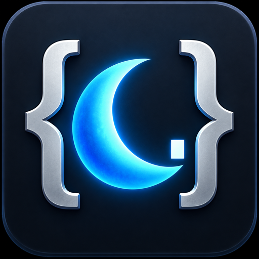

# LuaWorkbench



LuaWorkbench is a Lua editor for World of Warcraft. Write and run code in-game, save snippets for later, and keep them organized in folders. It works on its own and does not require another addon.

The editor includes syntax highlighting, code search, and a separate output panel for printed messages, return values and errors. You can also search through all your saved snippets, including their code.

- Run code with the Play button, **Ctrl+Enter**, or **F5**.
- Save with **Ctrl+S**, recover drafts after a reload, or return to the last saved version.
- Run saved scripts at startup, login or on a WoW event you choose.
- Adjust fonts, indentation, bracket completion and the output limit in Options.
- Resize the window, give the code editor more space, or minimize it while you play.

Open it with `/lua`, `/le`, `/luaeditor` or `/luaworkbench`. The **?** button lists the shortcuts and explains the available options.

Supports Retail, Forever and TBC, with translations for all 11 WoW languages.

**Please keep in mind:** This runs real Lua code in your game. Only run scripts you trust. A running script cannot be interrupted; an infinite loop can freeze the game. Automatic runs are off by default. Enable startup, login or a custom WoW event for each script; only its saved code will run.

LuaWorkbench's own code is MIT-licensed. Bundled libraries keep their original licenses and notices. The repository is private during initial development; contributions and translations will be welcome when it opens.

## Installation

Install the shared package for Retail, Forever and TBC into `Interface/AddOns/!!!LuaWorkbench`, then restart the game or reload. Snippets and settings are stored account-wide in `LuaWorkbenchDB`. Draft recovery is enabled by default and can be disabled in Options. Automatic runs are opt-in for each script and use the last saved code.

## Development

```sh
luacheck --no-color -q .
python3 scripts/check_lua_upvalues.py .
python3 scripts/validate_project.py
```

`Localization.lua` contains eleven translations. When adding or changing text, update every locale in the same change. The checks verify matching keys and alphabetical ordering. See [CONTRIBUTING.md](CONTRIBUTING.md).

Static checks do not replace in-game testing on each supported client.

## Local deployment

```sh
python3 scripts/deploy.py --flavor forever --target "$WOW_ADDONS_DIR"
```

Set `WOW_ADDONS_DIR` to your client’s existing `Interface/AddOns` directory. Supported flavors: `retail`, `forever`, `tbc`. Deployment copies runtime files, assets, bundled libraries and the shared TOC. It does not touch SavedVariables. The convenience `build.sh` used locally is intentionally ignored and is not part of this repository.

## Releases and licenses

See [RELEASING.md](docs/RELEASING.md) for the shared changelog and tag-driven uploads to CurseForge and Wago. No release is published by a regular branch push.

Original code and artwork use [MIT](LICENSE), attributed to LuaWorkbench contributors. [THIRD_PARTY.md](THIRD_PARTY.md) records the separate terms for bundled libraries.
